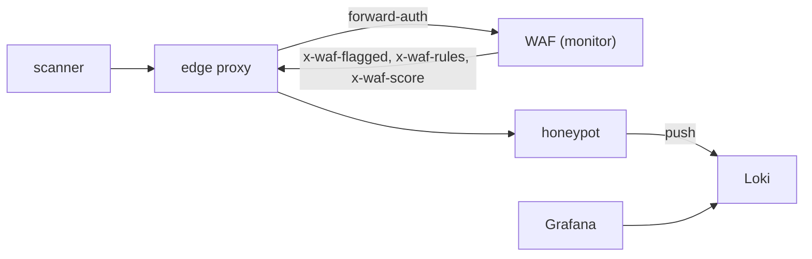

# honeypot

A small HTTP server that looks like a forgotten admin panel. It answers the paths
internet scanners probe (`/.env`, `/.git/config`, `/wp-login.php`, `/phpmyadmin/`,
`/actuator/env`, router exploits, ...) with plausible fake content and logs every
request as one JSON line on stdout.

It runs behind a WAF in monitor mode. The WAF passes its verdict to the honeypot in
`x-waf-*` request headers, so every log line holds both what the scanner sent and whether
the WAF caught it.



Nothing behind it is real: no database, no outbound calls, no stored data. The fake
secrets are random values generated at startup.

## Run

```sh
go run .
docker build -t honeypot . && docker run --rm -p 8080:8080 honeypot
```

| Variable | Default | Meaning |
|---|---|---|
| `ADDR` | `:8080` | listen address |
| `MAX_BODY` | `65536` | request body bytes read |
| `LOG_BODY` | `4096` | request body bytes logged |
| `LOG_PER_IP_MINUTE` | `120` | requests logged per client and minute, the rest is counted in a `suppressed` line |
| `LOKI_URL` | | push endpoint (`http://loki:3100/loki/api/v1/push`); when set, events go to Loki instead of stdout |
| `LOKI_BUFFER` | `10000` | events kept in memory while Loki is slow, newer ones are counted in a `dropped` line |
| `LOKI_BATCH` | `500` | events per push |

Events pushed to Loki carry the labels `job="honeypot"`, `event` and `waf_flagged`
(`true`, `false`, or `unknown` without a WAF in front).

## Loki and Grafana

`deploy/loki` builds a single-binary Loki with 30 days of retention. `deploy/grafana`
builds a Grafana with the Loki datasource (`LOKI_URL` environment variable, the Loki base
URL) and the `Honeypot` dashboard provisioned: requests by WAF verdict, top paths, clients,
user agents and fake pages, the rules that fired, and the requests the WAF did not flag.
Grafana has no login, so keep it off the public internet.

## Log line

```json
{"ts":"2026-11-19T20:00:00Z","event":"request","client":"203.0.113.7","method":"GET","host":"admin-portal.example","uri":"/.env","path":"/.env","proto":"HTTP/1.1","ua":"Mozilla/5.0","headers":{"Accept":"*/*"},"trap":"dotenv","status":200}
```

## License

MIT
